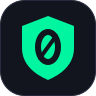

<div align="center">



# ZeroLeakage

**Zero bits leaked.** A privacy shield for Windows and Android that cuts telemetry, trackers and
unknown apps off the network, and encrypts every DNS lookup that is allowed through.

[](https://github.com/shatheitguy/ZeroLeakage/releases/latest)


[**Website**](https://shatheitguy.github.io/ZeroLeakage/) ·
[**Download**](https://github.com/shatheitguy/ZeroLeakage/releases/latest) ·
[Build from source](#build-from-source)

</div>

---

## Download

| Platform | File | Notes |
|---|---|---|
| Windows 10 / 11 (x64) | [`ZeroLeakage-1.4.0-x64.msi`](https://github.com/shatheitguy/ZeroLeakage/releases/download/v1.4.0/ZeroLeakage-1.4.0-x64.msi) | Self-contained: .NET is bundled, nothing else to install. |
| Android 10+ | [`ZeroLeakage-1.4.0-release.apk`](https://github.com/shatheitguy/ZeroLeakage/releases/download/v1.4.0/ZeroLeakage-1.4.0-release.apk) | Sideload: allow "Install unknown apps" for your browser or file manager. |

## Three protection modes

| | Mode | What it does |
|---|---|---|
| `01` | **Balanced Shield** | Telemetry, ad trackers and analytics SDKs are silently dropped. Apps keep working as before. |
| `02` | **Strict Guard** | Everything in Balanced, plus default-deny: any app you haven't approved must ask before it gets online (Allow / Allow once / Block). |
| `03` | **Total Zero-Leak** | Hard lockdown. Only apps you pin may reach the internet. |

## Windows

A dark-glass WPF desktop app with a frameless window, an animated mode switcher and a live connection feed.

- **Dashboard:** bento metrics (telemetry purged, DNS trackers dropped, firewall lockdown, DeepScan) and a live, filterable feed with one-click *Block domain* / *Kill app network*.
- **Firewall rules:** per-app Wi-Fi / Ethernet / VPN access and global kill switches.
- **DNS & filters:** AdGuard-style filter lists (real downloads and rule counts), 10 DoH resolvers plus a custom endpoint, DNSSEC validation with a live domain checker, offline GeoIP, allow/block lists, OS telemetry services and trace-log wiping.
- **Packet inspector:** *Inspect* on any feed row shows the matching filter rule plus a real DNS-over-HTTPS lookup of that domain: answers, TTLs, flags, DNSSEC result, Extended DNS Errors, the country of each IP and raw hex.
- **DeepScan AV:** two engines. **Microsoft Defender** (built into Windows) is the always-on shield; **ClamAV** (open source, Cisco Talos) is an optional on-demand second opinion, downloaded once, verified against its published SHA-256 and kept up to date daily. Quick, full or folder scans with either or both, a radar scan view, real threat history, and a ZeroLeakage quarantine for ClamAV finds.
- **Protected reset:** Restore Defaults asks for your Windows Hello PIN, fingerprint or password first.
- **Snapshots & settings:** restore points, start with Windows (on by default, hidden in the tray), tray behaviour.
- **Guard (new in 1.4):** a local, CrowdSec-style engine that runs as the *ZeroLeakage Core* Windows service. It bans known-bad IPs from public threat feeds (Spamhaus DROP, FireHOL Level 1, abuse.ch Feodo, Emerging Threats, blocklist.de, CINS Army) in Windows Firewall, and bans addresses that try to brute-force your Windows sign-in or scan your ports. Your own PC, gateway and DNS servers are never banned. Everything stays on this PC: no account, no reporting back.
- **Account & sync (optional, new in 1.4):** link this PC to your own ZeroLeakage Server with a pairing code or a username and password. Rules, filter lists and policy are copied exactly; your own changes sync to your other devices; anything your admin sets shows as *Set by admin* and can't be weakened. The password is never stored, only an encrypted device token. Unlink restores your previous setup.
- **Profile menu:** Settings, About (version and system details), *Check for updates* with one-click install, *Update antivirus definitions* and *Account & sync*.
- **Ask to Connect:** a toast slides in when an unknown app tries to get online in Strict Guard.
- **Post-install audit:** scores your privacy and applies hardening in one pass (a snapshot is taken first).
- **Update window:** temporarily opens the network for 15 minutes so updates can run, then locks down again.

> **Status:** DeepScan (Defender + ClamAV), Guard (real Windows Firewall bans through the Core service) and Account & sync are real. The firewall-rules, telemetry and DNS screens still run on `SimulatedProtectionEngine`, which **does not change the system yet**.
> The real back-end plugs in behind [`IProtectionEngine`](windows/ZeroLeakage.UI/Services/IProtectionEngine.cs).

## Android

A real on-device DNS firewall built on Android's `VpnService`. Nothing is routed off the phone except encrypted DNS.

- **Local DNS-only VPN:** only the virtual DNS address is routed into the tunnel, so normal app traffic never passes through it and battery use stays low.
- **Per-app attribution:** every lookup is matched to the app that made it (`getConnectionOwnerUid`).
- **Filter lists (AdGuard-style):** 4 built-in lists plus 25 subscribable ones, including AdGuard DNS filter (on by default), OISD, HaGeZi (Light/Multi/PRO, Threat Intelligence, native trackers for Xiaomi/Samsung/Huawei/TikTok…), StevenBlack, EasyPrivacy, AdAway, Peter Lowe, URLhaus, Phishing Army, NoCoin and parental lists. You can also add any list by URL. Supported formats: `||domain^`, `@@` exceptions, hosts files and plain domain lists. Lists auto-refresh every 3 days.
- **Allowlist and blocklist:** your own domains override every list.
- **Per-app firewall:** Wi-Fi and mobile-data kill switches for each app.
- **Encrypted DNS:** allowed lookups are resolved over DNS-over-HTTPS: Cloudflare (standard, Security, Family), Quad9, Mullvad, AdGuard, AdGuard Family, Google, Control D, DNS.SB, or your own endpoint.
- **DNSSEC:** on by default. The resolver validates each answer; a 🔒 in the feed marks validated answers, and failed validation is refused. An optional strict mode also blocks unsigned domains.
- **Packet inspector:** tap a lookup, then *Details*, to see the app, UID, network, IP/UDP header fields, transaction ID, flags, EDNS, the filter rule that matched, the resolver, latency, cache status, DNSSEC result, every answer with its TTL and country, and a hex dump of the query and response.
- **Offline GeoIP:** an opt-in download of the DB-IP Country Lite database (CC BY 4.0). Lookups run on the device.
- **Strict Guard prompts:** an actionable notification (Allow / Allow once / Block) appears the first time an unapproved app reaches out. The lookup waits a few seconds for your answer, so tapping **Allow** lets the page load straight away. Android's own background services (Google Play services, network stack) are never blocked; every app you can open, preinstalled Chrome included, can be approved from the Firewall tab.
- **Two ways to protect:** **Full Shield** (the local VPN: per-app firewall, prompts, live feed) or **Lite** (no VPN: Android's built-in Private DNS points at a filtering resolver such as AdGuard DNS, so ads and trackers are blocked for every app even when ZeroLeakage is closed; no per-app control).
- **Never offline because of DNS:** if your DoH provider is blocked on a network, ZeroLeakage fails over to other encrypted resolvers, then (optional, on by default) to the network's own DNS, and tells you on the dashboard.
- **Privacy X-ray:** lists every installed app that can read your screen (accessibility), read your notifications and messages, see what you type (keyboard), or use the microphone, camera, location, SMS, call logs and contacts, with a link to revoke each in Android settings.
- **In-app updates:** downloads the new APK inside the app and installs it only after checking its published SHA-256, package, version and that it's signed with ZeroLeakage's own key (Android asks you to confirm).
- **Quick Settings tiles:** *ZeroLeakage* (shield on/off) and *ZL mode* (Balanced → Strict → Total Zero-Leak).
- **Works with WireGuard and other VPNs:** if another VPN takes over, ZeroLeakage tells you and comes back when it disconnects, or use Lite mode alongside it.
- **Strict Guard quick setup:** approve popular apps (Chrome, Google, YouTube, Gmail, WhatsApp…) or all current apps in one tap; only new apps are asked.
- **What was blocked:** dashboard breakdown of trackers, telemetry, malware/phishing, parental, your rules, app firewall and DNSSEC failures.
- **Battery-friendly:** encrypted DNS connections are reused (no handshake per lookup), answers are cached for their real lifetime, and storage writes are rare.
- **Guard (new in 1.4):** a local threat engine. Answers that point at known malicious IPs are blocked, and it warns you when an app shows signs of infection (DGA-style random domains, DNS tunnelling, bursts of failed lookups), with a one-tap *Cut off app*.
- **Allowed apps work in every mode:** an app you allowed (or allowed once) also gets online in Total Zero-Leak, and the Firewall tab clearly marks *Allowed by you* and *Allowed once*. Prompts tell you whether an app is needed, recommended, optional or not needed online.
- **Feed history:** Live, Today, Yesterday and 7 days views, kept only on the phone for 7 days.
- **Quieter notifications:** you can hide just the "running" notice without silencing ZeroLeakage's other alerts.
- **Account & sync (optional, new in 1.4):** link the phone to your own ZeroLeakage Server with a pairing code or username and password. Your server's protection is copied exactly, your changes sync to your other devices, and admin settings show as *Set by admin*. Never required.
- **Profile menu:** About (version, device and app details), *Check for updates* and *Account & sync*.

> Tip: set Android **Private DNS** to *Off* or *Automatic*. A custom Private DNS host bypasses the on-device filter.

## How the Android shield works

```
 app ──DNS query──▶ 10.111.222.2 (virtual, inside the local VPN)
                        │
                        ├─ who asked?  getConnectionOwnerUid → package
                        ├─ blocklists + per-app rules + current mode
                        │
            blocked ◀───┴───▶ allowed
           NXDOMAIN            DNS-over-HTTPS (TLS) → resolver
```

## ZeroLeakage Server

Self-hosted, network-wide protection in Docker (AdGuard Home / Zenarmor style, DNS level): filter lists, 28 blockable services (TikTok, YouTube, Instagram…), web categories, SafeSearch, schedules, a device list, per-device reports, local DNS records, blocking of encrypted-DNS bypass, and **Guard**, a local CrowdSec-style engine (threat feeds, flood / tunnelling / brute-force detection, bans). The admin manages users; each user links their own Windows and Android apps, which then follow the server exactly. Multi-arch image: `ghcr.io/shatheitguy/zeroleakage-server`. See [server/README.md](server/README.md).

## Build from source

Each part has its own folder, toolchain and output.

```text
windows/   .NET 10 · WPF · WiX 5        →  .msi
android/   Kotlin · Jetpack Compose     →  .apk
server/    Go · Docker                  →  container image
docs/      project website (GitHub Pages)
```

**Windows** (needs the .NET 10 SDK):

```powershell
powershell -ExecutionPolicy Bypass -File windows\build-msi.ps1     # -> windows\artifacts\msi\ZeroLeakage-1.4.0-x64.msi
dotnet run --project windows\ZeroLeakage.UI                          # run the UI
```

**Android** (needs JDK 17+ and the Android SDK):

```powershell
cd android
.\gradlew.bat assembleRelease      # -> app\build\outputs\apk\release\ZeroLeakage-1.4.0-release.apk
.\gradlew.bat testDebugUnitTest
```

The release APK is signed with the local debug key. Use your own signing key before publishing to a store.

**Brand assets:** the app icon, installer artwork and site logo are generated from one geometry:

```powershell
powershell -ExecutionPolicy Bypass -File windows\tools\New-AppIcon.ps1 -OutFile windows\ZeroLeakage.UI\Assets\ZeroLeakage.ico
powershell -ExecutionPolicy Bypass -File windows\tools\New-InstallerArt.ps1 -OutDir windows\ZeroLeakage.Installer\Art
```

## Privacy

ZeroLeakage has no account, no analytics and no servers of its own. Rules, counters and the live feed stay on your device.
The only traffic it creates is the encrypted DNS-over-HTTPS request to the resolver you choose, filter-list downloads from the list publishers you enable, and the GeoIP database download if you ask for it.

IP geolocation by [DB-IP.com](https://db-ip.com) (CC BY 4.0). Filter lists belong to their respective authors and keep their own licenses.
